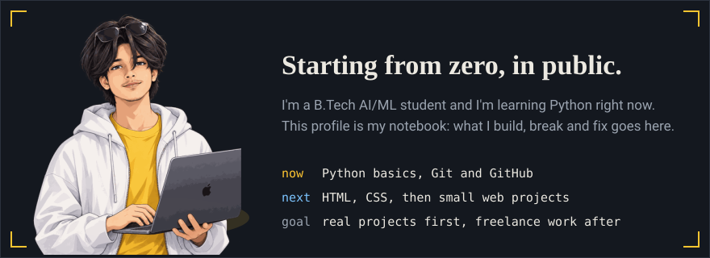
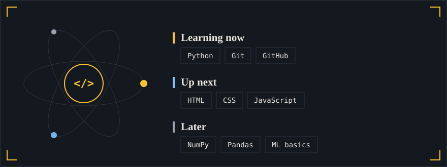
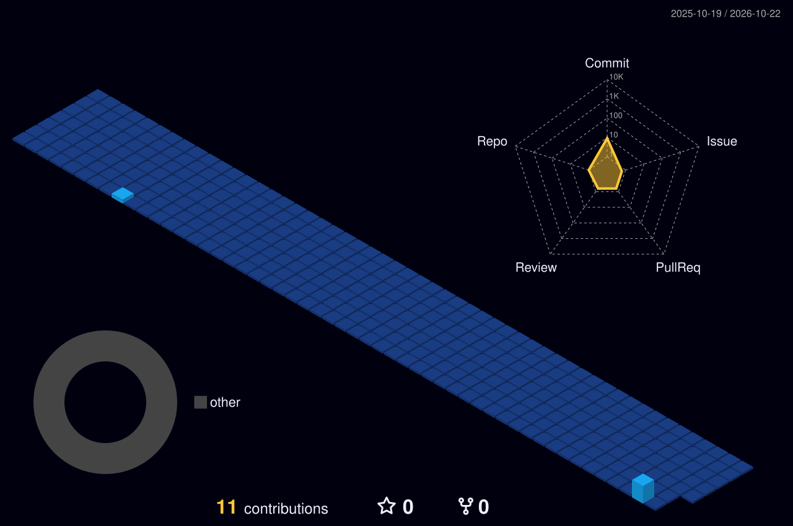

### Now building

| Project | What it is | Status |
|---|---|---|
| `hello-python` | First Python scripts: calculator and a number guessing game | in progress |
| `portfolio-website` | A plain HTML + CSS personal site, hosted free on GitHub Pages | up next |

*Update this table every time you push a new project.*
